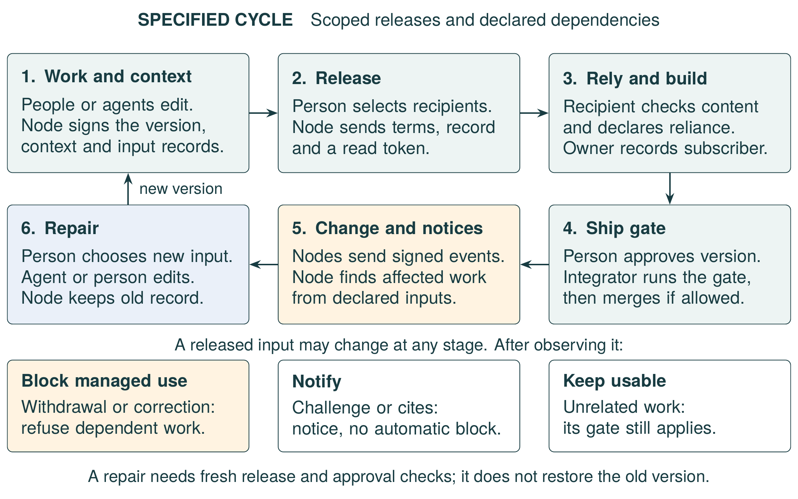
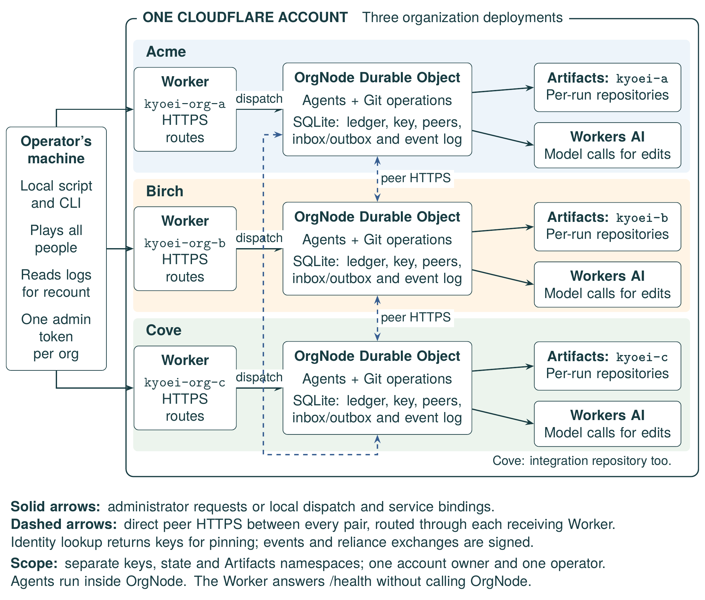

**KEY WORDS**

Version control; multi-agent software engineering; provenance; usage control;
withdrawal and correction.

# Introduction

We describe the context and goal of collaboration across organizations. We then
use a request-signing example to explain the requirements. Finally, we present
Kyoei's approach, implementations and evaluation scope.

## Context and goal

Organizations combine software and research from their own teams and external
contributors. People and AI agents work in parallel, while teams remain
responsible for the results they accept. They need the evidence and terms for
each input, and a response when its owner corrects or withdraws it.

We want people and AI agents to build shared results while each organization
retains authority over its contributions. Kyoei means mutual prosperity and
names this vision of human and AI symbiosis. We propose a federated collaboration
layer for evidence-backed contributions. In this design, organizations control
their own nodes, keys, and decisions while exchanging versioned results.
Our technical goal is to help teams identify affected work, check permitted use,
and approve repairs.

Git records versions and declared authorship; code hosts add review and merging.
Registries and advisories identify withdrawn or vulnerable package versions.
Teams must still connect those records to their declared dependencies,
permitted uses and repair decisions across organizations. We propose Kyoei as a
shared layer for those connections, which teams can also implement themselves.
The design extends versioned collaboration from files to claims, supporting
evidence, and declared dependencies. It retains Git for code and history.
Federation describes the intended authority model: our Cloudflare experiment
uses one account and one operator, so it does not establish independent
administration or provider independence.

## A request-signing example

Consider three organizations developing a client library for network requests.
Birch (B) supplies a function that signs requests with a shared secret. Acme (A)
builds a helper that retries failed requests and calls Birch's signing function.
Cove (C) integrates their contributions with its own client code. Each
organization's agents work in separate repositories.

A *claim* is a statement about a result that a recipient can assess and build
on. Birch could claim that its function produces the specified signature for a
given request and secret. A matching test output would supply evidence. The
code version, producer, rationale and declared inputs describe the result's
provenance. A *contribution* is the signed record of a claim and its provenance. The
organization's signature binds that record to a key; it does not establish the
claim's truth.

Birch then discovers a snippet whose licence it cannot establish and withdraws
the signer. Under the collaboration's rules, Acme's retry helper and Cove's
dependent client code must wait for repair before they can ship. Birch's
documentation, which merely cites the signer, needs a notice. An unrelated
README update at Cove remains eligible to ship.

Cove has also released an alternative signing function to Acme. Acme can adapt
its helper to that alternative instead of waiting for Birch's replacement.
The revised helper needs fresh review and approval. This example requires a
record of the exact dependency and its permitted use: a clean Git merge alone
cannot decide whether the helper may still ship.

## Requirements

The example requires five conditions for sharing and using a claim:

1. **Context.** Record the task, rationale and exact inputs of each change, so
   a recipient can inspect its basis.
2. **Terms.** State the recipients, purposes and expiry of a release, and check
   those terms when a recipient uses it.
3. **Concurrency.** Expose overlaps while agents work, then check both the merge
   base and the inputs before accepting a change.
4. **Change after use.** Follow declared dependencies after a withdrawal or
   correction, identify work that needs repair, and keep unrelated work usable.
5. **Authority.** Let each organization control its keys, records and decisions,
   with agents acting under delegation from its people.

## Approach and scope

We specify a protocol in which each organization runs a node that records signed
contributions and scoped releases. Nodes exchange change notices and compute
their own affected work from declared dependencies. People choose and approve
repairs. Section 5.8 identifies implementation gaps, including input-grant checks
and crash recovery.

We built two implementations. The TypeScript port runs one Cloudflare Worker,
Durable Object and Artifacts namespace per organization, with a repository for
each agent run. The earlier Python research prototype runs separate institution
processes with their own stores and signing keys. It implements releases,
purpose checks and repair, but lacks intents, git notes and the ship gate;
several rules also differ from the protocol specified here.

We compare the research prototype with plain tools and an *equipped reference*
that we built from the same libraries to provide the same controls. We also
record deployed Cloudflare runs. The organizations and people are simulated, and we wrote
the scenarios; these experiments do not establish savings for real teams.

Cloudflare asks how concurrent agents coordinate work, retain context and decide
what ships.^1^ Table 1 relates the port's mechanisms to that call.

Table: Cloudflare's questions and the mechanism in the Kyoei port that answers
each.

| Question or theme in the call^1^ | Kyoei mechanism | Section |
| --- | --- | --- |
| How do agents know what other agents are working on? | Declared intents expose same-file overlaps to people; the current agents receive no warning. | 4.2 |
| What happens when they make conflicting changes? | The gate refuses stale bases and blocked inputs. A repair needs fresh approval. | 4.5, 4.6 |
| How do you review everything they produce? | Approval binds an exact version and its inputs. The gate displays each check. | 4.5 |
| How do you keep track of not just what changed, but why a change was made? | A git note carries the signed task, rationale, inputs, model, and prompt digest. | 4.2 |
| Compare several changes and decide which one should ship (a theme of the call) | The gate checks eligibility; it does not rank alternatives. | 4.5 |

Kyoei controls *managed use*: operations that pass through a node's checks.
A recipient that modifies its own node can bypass those checks, and fetched
copies remain outside them. People must assess correctness, licence validity
and ownership. Kyoei records their decisions; it cannot find a dependency that
no contributor declared.

# State of the art and requirements

In this section, we review version control and code hosting, package registries,
and agent workspaces. We then cover open research platforms, provenance records,
usage control, and the handling of withdrawn research. Finally, we compare what
these tools provide with what Kyoei adds.

## Version control and code hosting

Git stores content-addressed history. A commit identifies its exact tree and
parents, and it can carry a signature.^4^ Author and committer fields are
declarations: a verified signature binds a commit to a key, and attributing that
key to a person needs a separate trust decision. Git notes attach text to a
commit under a separate reference without changing the commit.^3^ Code hosts add
pull requests, review, branch protection and merge queues. They can give outside
collaborators access to one repository,^5^ and they build a dependency graph
from package manifests.^6^

These tools answer "what changed", "who changed it" and "who may write here". A
token can expire and carry a note about its purpose,^24^ but the note does not
enforce that purpose at the point of use. Access also does not follow a
contribution once another organization fetches it. A dependency graph tracks
declared packages, not which change relies on another organization's
contribution. A team that needs that record, and a response when the
contribution changes, must build an integration, as our equipped reference does.

## Package registries and advisories

Package registries already withdraw published versions from new use. Go marks a
version as retracted in the module's own file, so the go command stops upgrading
to it but keeps existing builds working.^25^ PyPI and Cargo let an owner yank a
release that a pinned requirement or a lock file can still use.^26,27^ npm
prints a warning at each install of a deprecated version.^28^ A published GitHub
advisory can alert the repositories that depend on an affected version,^29^ and
Dependabot can open a pull request that updates the dependency.^30^

These mechanisms change version selection or warn users, and some keep pinned
versions usable. Kyoei instead refuses new managed use once a node observes a
withdrawal. It adds typed reliance records and repair decisions that each
organization makes for its own work. Private registries can also restrict
access, so the difference lies in this response, not in access control.

## Agent workspaces and concurrency

Coding agents work in isolated workspaces: worktrees, sandboxes or forks. In a
plain Git workflow, their conflicts appear at merge time. Research tools report
them earlier. Palantír shows each developer which artifacts other workspaces are
changing,^31^ and Crystal merges parallel changes in the background to report
conflicts before anyone merges.^32^ Kyoei applies the same idea across
organizations through declared intents (section 4.2). Cloudflare Artifacts lets
a Worker create and fork Git repositories, mint repository-scoped tokens and
subscribe to repository events.^2^ Multi-agent frameworks structure
conversations between agents, tools and people;^16^ a deployment must still
define release authority and the response to changes across organizations.

Three kinds of conflict matter. A *text conflict* occurs when two changes edit
the same lines; Git detects it at merge. A *file overlap* occurs when two
changes edit different lines of the same file: Git merges them, although neither
change was reviewed with the other. A *dependency conflict* occurs when a change
merges cleanly but relies on an input that is no longer valid; a text merge
cannot detect it. Kyoei and the equipped reference both check declared
dependencies alongside Git.

## Open research platforms

Open research platforms let anyone contribute to a shared problem under an
automatic check. Yukon, for example, runs public challenges in which a verifier
checks each submission and a harness scores it; a candidate that clears an
improvement threshold is promoted.^7^ The platform owns the official record of a
challenge, its scoring and its corrections.

We replayed the public records of two such challenges.^20^ The lineage of a
promoted result spans a median of 12 declared models in one challenge and 21 in
the other. One model field per submission therefore does not describe what a
result builds on. When a challenge's checker changed, Git history alone named
the earlier outputs to review. Over three checker changes, Git-only methods
missed 1 of 406 such outputs, so inside one public repository, dependency
tracking added little over Git. Kyoei is complementary: its research prototype
imports such records as labelled inputs and never changes them, although the
port has no imports. Its target is the work that continues after a result, such
as joint write-ups, reproductions and follow-up projects across institutions.

## Provenance, licence and supply-chain records

W3C PROV describes entities, activities and agents, and how one entity was
derived from another.^8^ The Citation Typing Ontology types citations, for
example "uses method in" or "disputes".^9^ SPDX identifies licences,^10^ and
supply-chain frameworks such as SLSA and in-toto record how an artifact was
built and by whom.^11,12^ These records describe origin. They do not carry a
purpose-bound grant, check it at the point of use, or start a repair in another
organization when a source changes. One store of Kyoei's research prototype maps
its relations to PROV and the Citation Typing Ontology; the port has no such
export.

## Usage control and authorization

Usage control models allow continuous authorization: a decision can change while
a use is ongoing, so a revoked right stops a use that has already started.^13^
Zanzibar applies changes to permissions and content in order, so a user removed
from a folder does not see content added after the removal.^14^ Leases bound how
long a client may use cached data, including permissions, without asking the
server again.^15^ ODRL expresses permissions, prohibitions and duties, and a
rule can name the purpose of a use.^33^ Macaroons attach caveats such as an
expiry to a bearer token; any holder can add a caveat but cannot remove one.^34^
Kyoei applies these ideas at the boundary between organizations, where the
recipient's own node checks a release's terms before each managed use.

## Withdrawal and correction in research

Retraction notices, retraction databases and notification services alert readers
after the fact. The RetractoBot trial sent 246,749 one-time emails to authors
who had cited retracted articles. Of 15,667 survey responses from notified
authors, 80.6% said that they had not known about the retractions. Over the
following year, the emailed group's retracted articles were not cited
significantly less often than those in the control group.^17^ Usman and Balke
separate dependent citations, which build on the retracted work, from
non-dependent ones, which discuss, criticize or negate it.^18^ In a case study
by Bar-Ilan and Halevi, 83% of 238 citations made after a retraction cited the
retracted work as legitimate prior work.^19^ Kyoei therefore checks at the point
of use rather than after the fact, and it responds according to the type of each
link.

## Requirements and the Kyoei contribution

No single Kyoei mechanism is new. Our contribution is their combination at the
boundary between organizations: signed contribution records with typed
relations; releases that the recipient's node checks at each managed use;
affected work that each node computes from its own declared relations; and
repair under human approval, all on top of Git. The equipped reference shows
that a team can build the same combination itself, so we contribute it as a
shared layer with a specification and an evaluation.

Table: Five challenges, existing tools, and the proposed Kyoei integration.
Section 5.8 lists implementation gaps; these are design goals, not complete
port guarantees.

| Challenge | Existing tools provide | Kyoei design | Section |
| --- | --- | --- | --- |
| 1 Context | Commit history, signatures, notes, pull request text | A signed contribution record with task, rationale, typed inputs, model and prompt digest, in the owner's ledger; the port also stores it as a git note | 3.2, 4.2 |
| 2 Terms | Repository access per role; tokens with an expiry; licence identifiers | Releases for named organizations, stated purposes and an expiry, checked at each managed use | 3.3, 4.3, 4.5 |
| 3 Concurrency | Isolated workspaces; text conflicts at merge | In the port: declared intents and early overlap signals; file overlaps and dependency conflicts at the ship gate | 4.2, 4.5 |
| 4 Change after use | Reverts, issues, messages; yanked or retracted package versions; advisories that alert dependents; notices after the fact | Signed withdrawal and correction events; each node computes its own affected work; repair with human approval | 4.6, 4.7 |
| 5 Authority | Accounts and roles on one host | One node, key and namespace per organization; only people release, approve and withdraw | 3.1, 4.1, 4.3 |

# Model and definitions

In this section, we define the participants and the collaboration cycle. We then
define contributions and their relations, releases and the managed use they
authorize, and the changes that start a repair. We close with refusals, repairs
and the scope of a collaboration.

## Participants and the collaboration cycle

An *organization* controls its people, agents, keys, repositories and decisions.
In the introduction's example, B and A contribute and C integrates; any
organization can take both roles. Each organization runs one Kyoei *node*, which
keeps the organization's ledger and signing key, pins the public keys of its
peers, and sends its outgoing events. An *actor* is a person or an agent of one
organization. Agents produce work under a *delegation* from a person, which
names the allowed tasks, files, purposes and expiry. Only a person releases a
contribution, approves or ships it, withdraws or challenges it, records dissent
or chooses a repair.

Organizations join by pinning peer keys. Agents produce contributions in
separate repositories; people release them and approve their integration. A
change to a shared input starts a repair cycle among its declared dependents.
Reuse in another collaboration needs the scope checks in section 3.5.

## Contributions and relations

A *contribution* is the signed record of one claim. The record binds the
result's commit and content root, and with them any evidence committed with the
result. It names the organization, actor, task, rationale and declared inputs,
and the interfaces that the result provides, such as `signer@1`; agent records
also name the model and prompt digest. The record states no terms: releases
carry them.

An *input* is a typed relation from the contribution to a versioned target:

- *builds-on*: the contribution depends on the target. Only this relation
  blocks.
- *cites*: the contribution mentions the target. It produces a notice.
- *challenges*: the contribution disputes the target. It produces a notice and
  keeps the disagreement visible.
- *reproduces*: the contribution repeats the target's result. It neither blocks
  nor produces a notice.
- *supersedes*: a contribution of the same owner replaces the target.

A *challenges* relation records disagreement inside one's own contribution; a
*challenge* is a separate signed statement (section 3.4). The port registers
each input except a supersedes input with its owner, so the owner's change
events reach every organization that declared one of the other relations. The
research prototype uses different blocking rules (section 5.1).

## Releases and managed use

A *release* names one contribution by its record digest, the recipient
organizations, the purposes and an expiry, and the owning organization signs it.
*Managed use* is an operation at an enforcement interface, where the recipient's
node checks that a release covers the use. In the current port, the ship gate
checks the candidate's release and its declared builds-on inputs for `integrate`,
including expiry and completed reliance registration (section 5.8). It uses the
latest authenticated owner state held locally; it does not query every owner
for every use. A release there also carries
a read token for one repository, which Artifacts checks for scope and expiry on
a Git fetch. That bearer token neither enforces the recipient's stated purpose
nor prevents onward copying, and a raw fetch runs none of the node's checks,
even though Kyoei issued the token. Repository access is therefore distinct from
approved reuse. In the research prototype, managed use is a retrieval, use,
publication or release through the node. In both, a copy already fetched is
outside managed use.

## Changes, affected work and notices

A *withdrawal* ends the owner's releases and endorsement of a contribution; it
does not rescind licences already granted. A *correction* is a new contribution
that supersedes an old one. A *challenge* is a signed statement by a person of
any member organization that a contribution is wrong; it does not block by
itself. *Dissent* is a recorded disagreement with a notice or a challenge; it
does not clear a withdrawal, grant permission or restore eligibility to ship.

Let $O_N$ be the contributions that node $N$ owns, and let $E_N$ be the
relations declared by the records that $N$ holds: its own and those released to
it. For a contribution $c$ that changed, was blocked or was challenged, the
*affected set* of $N$ is

$$A_N(c) = \{x \in O_N : x \xrightarrow{\text{builds-on}^{+}} c \text{ in } E_N\},$$

the contributions of $N$ that reach $c$ through one or more builds-on relations
in $E_N$. A node that is not a recipient of $c$ learns of a change through
`blocked` events and of a challenge through `affected` events (sections 4.6 and
4.7). The state of $c$ itself is checked separately; it needs no relation to
itself to be refused. The *notice-only set* $M_N(c)$ holds the contributions of
$N$ that cite or challenge $c$ and are not in $A_N(c)$. Each node computes both
sets itself.

A *notice* is a node's record that one of its contributions is in $A_N(c)$ or
$M_N(c)$. It has six fields: the affected item; a reference to its version,
which the port gives as the commit, record digest and content root; the source
event; who can act; any dissent; and the allowed repairs.

## Refusals, repairs and collaboration scope

In the port, a refused managed use carries one of seven codes: `withdrawn`,
`replacement-required`, `new-grant-required`, `lease-expired` for an expired
release or envelope, `human-required`, `stale-base` and `not-authorized`. A
malformed request returns `invalid-request`, and an event identifier reused with
another payload returns `conflict`. A *repair* creates a new version with
revised inputs or a current base, and it ships only after fresh approval and all
gate checks pass. The owner of blocked work can instead withdraw it, which ends
its use without making it shippable.

A *collaboration* is the scope in which releases, relations and notices apply. A
node refuses a relation into another collaboration, except to a labelled import,
and it does not disclose the state of another collaboration's work. An import
needs an explicit grant for its new scope; the label alone neither authorizes
access nor exposes the source collaboration's private lineage. A signed record
names its deployment, collaboration and owner under a versioned signing tag, and
a receiver checks them against the envelope and its membership records. A valid
signature under an organization key therefore does not make a record usable in
another collaboration that trusts the same key; moving the record there needs an
authorized import with a new record identity.

# The Kyoei protocol

In this section, we specify the protocol; section 5.8 reports which parts the
Cloudflare port implements and tests. We describe setup, signed envelopes and
their delivery. We then follow one change through work, release, reliance and
the ship gate. We describe withdrawal, correction and repair, then challenges
and dissent. Finally, we give the threat model and the evidence for each
property.

## Setup, envelopes and delivery

Each organization creates a signing key. The research prototype and the port use
ML-DSA-65, a post-quantum signature standard.^21^ Organizations exchange key
fingerprints out of band and pin them. On Cloudflare, each organization deploys
the same Worker code with its own Durable Objects,^23^ Artifacts namespace^2^
and secrets, so one organization's bindings cannot reach another organization's
storage or repositories.

Every message between nodes is a signed envelope. An envelope names its issuer,
audience, kind, collaboration, payload, issue time, expiry and nonce. The
signature covers a canonical encoding of all fields, including a protocol
version and a deployment identifier. A receiver refuses an unknown issuer, an
invalid signature, an expired envelope, and a wrong audience, deployment or
collaboration. It also checks authority over the named object: a pinned key
alone cannot withdraw another owner's contribution, and only the owner of the
old record may issue `correct`. The event kinds are `release`, `rely`, `intent`,
`overlap`, `withdraw`, `correct`, `blocked`, `affected`, `challenge`, `dissent`
and `signoff`.

Delivery needs more than a valid signature. Each event keeps a stable identifier
across retries, and a durable inbox applies it once: a retry returns the
existing receipt, and reusing the identifier with another payload is refused. An
event retried after its envelope expired is re-sealed with the same identifier
and payload. A receipt means that the recipient committed the effect, its inbox
record and any events that the effect caused. The sender keeps each outbox entry
until that receipt arrives, and after a crash it reclaims and resends the
entries that it had claimed. A permanent refusal stays in the sender's outbox
with its error and appears in its log. These rules assume that storage is not
restored to an older snapshot and that clocks support the expiry checks.
Signatures do not encrypt, so envelopes travel over authenticated HTTPS between
pinned endpoints, and bearer tokens never appear in git notes, logs or error
messages.

## Work and context

Before an agent run starts, its node creates a repository for the run from the
head of the integration repository and mints a write token scoped to that
repository. The run declares an *intent*: its task and the files it may change.
Each node sends the intents of its runs to the integrator as signed `intent`
events and closes each one when the run's contribution is recorded. The
integrator's node compares the open intents of every organization's agents by
exact file path and sends an `overlap` event to each organization involved.
People see the overlap in the terminal view while the work runs, and agents are
not told; an overlap warns and does not block. The model returns its edit as
JSON, and the node accepts only files inside the run's file list and under a
size limit. The node, not the model, holds the write token. It commits the edit
and writes the contribution record as a git note under `refs/notes/kyoei`: the
task; the rationale; the inputs and their relations; and the model and prompt
digest. The node signs the record and stores it in its ledger. A client that
fetches `refs/notes/kyoei` can read the note with `git log --notes=kyoei`; a
plain clone does not fetch notes.

Releases, approvals, and relations identify a record by the digest of its fields
except the signature. This includes the commit identifier: two records about
one commit can differ, and a changed record needs fresh signature and approval.
Notes themselves give no authority because they can change without changing the
commit.^3^

Figure 1 summarizes the specified workflow cycle, not a conformance result.
An input can change before or after a dependent contribution ships. A repair
creates a new signed version that must pass release, reliance and approval
checks again; section 5.8 lists checks the port omits.

{#fig:workflow-cycle width=100%}

## Release

A person releases a contribution, and the organization's own node refuses a
release by an agent with `human-required`. Peers see the organization's
signature, not the person. The node mints a read token for the contribution's
repository and sends a signed `release` envelope to each recipient. The envelope
names the contribution, the purposes and the expiry, and it carries the token,
which expires with the release.

Git object names depend on the repository's format, SHA-1 by default, so the
record also binds the released files with its own hash. Its content field
carries a BLAKE3 root computed over the canonical path, the Git mode and the raw
bytes of each committed file.  A recipient checks the record's signature and
expected scope, then recomputes the root from the exact commit that it fetched.
The root authenticates the committed files under the hash and signature
assumptions. It does not authenticate parent commits, tags or notes, and it
proves neither correctness, permission nor secrecy. Symlink targets are hashed
as bytes without being followed. Submodules and paths with an empty, `.`, `..`
or `.git` segment are refused, but paths that differ only in letter case are
accepted.

A release carries the full signed record, and its read token opens the whole
repository and its history, so no release selects which evidence or inputs a
recipient sees. If the files or history hold unreleased material, as a fork's
history can, the owner must first publish a separate export repository. That
export helps only if no other authorized repository exposes the same version.
Revoking a token removes only that credential: if two releases grant tokens for
the same repository, revoking one leaves the other, and the recipient can still
fetch the withdrawn version. The Artifacts documentation also does not say
whether a revocation stops a clone already in progress.

Ownership of a derived contribution grants no permission over its inputs.
Consider a signer that B releases only to A. A then releases to C a helper that
builds on that signer. A's signature alone cannot authorize that exchange. A's
node therefore refuses the release unless B's grant to A allows release to C for
every proposed purpose, and it ends the release no later than B's grant. The
node checks only builds-on inputs, infers no permission from a builds-on link
and does not interpret licences.

## Building on released work

An agent in a recipient organization declares a relation to a released
contribution. The recipient's node checks that a release for building on the
contribution is in force, with the purpose `contribute` in the port, and records
the relation. It then sends a signed `rely` event to the owner. The owner
records this *reliance*, whatever the relation type, so it knows which
organizations must receive its changes. The owner registers a subscriber only if
it released the contribution to that organization.

A new subscriber can arrive after a withdrawal. The owner therefore reads its
current state and registers the subscriber in one serialized step, and returns
that state in its reply; otherwise a withdrawal between the two steps could
reach neither the reply nor the subscriber. The reply binds the request, the
record, the scope and the owner's state revision. The receiver keeps the newest
revision, and a delayed release never clears an observed withdrawal. Unknown
state leaves the reliance pending, and the gate refuses dependent work with
`not-authorized` and the reason "owner state unknown". A node shows missing
state, failed delivery and unresolved inputs as unresolved; it never shows such
a contribution as clear to use. This closes the local registration race under
the delivery rules above; it does not make the reply globally current.

## The ship gate

Before the integrator merges a contribution, its gate checks six conditions: the
record's signature; its content root; a release to the integrator that covers
this purpose; its builds-on inputs, which must have no unresolved withdrawal or
correction and releases that still cover the use; a person's approval; and a
base that is current for its files. The base is current when it is on the main
line and no later merge changed a file that the candidate also changes. A change
on a stale base therefore returns `stale-base` even when its text does not
conflict. The gate shows each check and its reason, and it runs no build or
test.

Approval binds the candidate commit, the contribution record, its content root,
its inputs and the merge base, so a changed diff or input needs fresh approval.
The gate's decision and the Artifacts ref update are separate effects, and no
transaction spans them. The node therefore conditions the update on the reviewed
base, keeps an unknown Git outcome unresolved rather than failed, and reconciles
it against the actual ref and its note. The authorization point is the local
decision, so a withdrawal observed after it still triggers repair.

## Withdrawal, correction and repair

A person at the owning organization withdraws a contribution. The owner's node
revokes every read token that it issued for that contribution and sends a signed
`withdraw` event to every recipient and subscriber. Each receiving node computes
$A_N(c)$ and $M_N(c)$ over the records it holds. It blocks managed use of
$A_N(c)$ with `withdrawn`, opens a notice for each item in both sets, and leaves
every other item unchanged. A withdrawal that arrives before its release leaves
a tombstone, so the late release arrives withdrawn.

Blocked work can have dependents in a third organization. When a node blocks one
of its own contributions, it sends a signed `blocked` event to each organization
that declared reliance on that contribution. Each receiving node checks that the
sender owns the named input version, then computes its own affected work. Status
thus follows declared relations, and no node sees more of the graph than the
records it holds. Until the `withdraw` or `blocked` event arrives, a recipient
can still allow managed use of a released item, but no longer than its release.
Every release expires, and no onward release outlasts the grants of its
builds-on inputs (section 4.3).

A correction creates a new contribution that declares `supersedes c`. The owner
sends `correct` to existing recipients and subscribers, even if the new version
is not released to them. A recipient marks the old version as
`replacement-required` and propagates the effect to its dependents. It gains no
access to the replacement, and an earlier withdrawal stays in force. A recipient
can also select an alternative: an unblocked contribution that its node may
build on and that provides an interface of the blocked input, such as
`signer@1`. The node lists the alternatives and the owner's replacement, if one
exists, and never applies either silently. An alternative from another
organization does not supersede the original owner's record.

A repair keeps the old blocked version for traceability. If two inputs are
withdrawn, a repair that replaces only one stays blocked, and the port refuses
to plan it. A matching interface name does not establish a valid replacement,
and a clean rebase establishes neither equivalent behaviour nor correctness. The
reviewer must therefore assess the new input and its evidence for the
dependent's task.

## Challenges and dissent

A person at any member organization can challenge a contribution. A challenge
produces notices for the affected and citing work, with its source. The owner
can withdraw or correct the contribution, or record dissent; the integrator can
also decide not to ship. Each response stays in the record.

A notice must also reach organizations that rely on an affected result. Suppose
A's helper builds on B's signer, and C's integration builds on A's helper. A
challenge to the signer does not block the helper, so forwarding only `blocked`
events would leave C unaware. A's node therefore sends an `affected` event for
its helper, bound to the helper's version and a stable cause identifier. C
checks A's authority over that helper and computes notices from its own declared
relations. The `affected` event neither lets A withdraw B's signer nor lets C
treat the challenge as a proven defect. A citation-only notice does not
propagate, and nodes deduplicate each cause and version. Dissent goes to the
organizations that received the notice. An `affected` event carries only the
challenge evidence that its recipient is allowed to see, and it marks withheld
evidence as withheld. C can then verify A's statement about the helper but
cannot assess a hidden challenge.

## Threat model and properties

Each organization's node enforces the protocol for that organization's own
people and agents. We therefore assume that each organization runs an unmodified
node. Under that assumption, we consider five threats: a party that forges or
replays events; a person or agent that tries to use work beyond its terms; an
agent that exceeds its delegation; material from another organization that
contains instructions for an agent; and a node that leaks the state of another
collaboration. The protocol targets seven properties. They are requirements, not theorems
or assertions that every implementation satisfies them.

- **P1 Local authority.** No node writes another node's records. Each node
  computes its own affected set.
- **P2 Human decisions.** An agent cannot make a decision that section 3.1
  reserves for a person.
- **P3 Dependency scope.** Once an input is blocked, downstream blocking follows
  only builds-on relations. Its owner's withdrawal also blocks the input itself.
- **P4 Reach.** Every recipient of a changed contribution, and every
  organization that declared reliance on a blocked or affected one, receives an
  event.
- **P5 Integrity.** Forged, expired and misaddressed events are refused, and a
  replayed event has no second effect.
- **P6 Isolation.** A node refuses relations into another collaboration and
  hides the state of another collaboration's work, except for explicitly
  authorized imports and their permitted disclosures.
- **P7 Terms.** A node refuses managed use that no release in force covers by
  recipient, purpose and expiry, and an onward release beyond the grants of its
  inputs.

P3 and P4 hold relative to the *declared* relations: a dependency that nobody
declared cannot be found by any node. P4 also assumes that each node on the path
cooperates, keeps its outbox and retries each event until it is acknowledged; no
finite delivery deadline follows. P2 rests on actor roles checked by the local
node. In the prototype runs, one parent process generated every key. In the
port, one administrator token per node authorizes every person action, because
the request names the actor, so the token's holder can act as any of that node's
people. Neither implementation establishes independent key custody or
independent human approval.

Table: Who enforces each property, and the evidence for it in each
implementation. Port test names refer to the port's acceptance tests (section
5.8); "weak" marks a test that asserts less than its name states.

| Property | Enforced by | Research prototype | Cloudflare port |
| --- | --- | --- | --- |
| P1 Local authority | Each node, for its own records | Withdrawal run: every request signed by the acting institution; no process held another institution's store | Separate Worker deployments with no shared binding |
| P2 Human decisions | The acting organization's node | Fault class "delegation escalation": an agent's release refused with `human-required` | R01 (weak) and R13; no deployed run had an agent attempt a person-only action |
| P3 Dependency scope | Each node, over the records it holds | Diagnostic notices match declared reliance; refusal at every new use after a block is not established | R06 (weak), R08 and R11; the deployed run blocked only dependent lines |
| P4 Reach | The owner's node, then each node that forwards `blocked` | One loopback run delivered the expected notices; no partition, restart or expiry test | R14 (weak), R18, R22, R23 and local crash-recovery tests R26, R27, R37 and R39 (section 5.8) |
| P5 Integrity | The receiving node | Fault classes for forgery, expiry, replay, reordered status and key rotation, under the pass rule of section 5.2 | R02 refuses nine kinds of bad envelope; R23 |
| P6 Isolation | Each node | Third-collaboration scans and base-store tests; no information-flow or metadata-privacy proof | R03 for record scope; one collaboration per node, with no imports |
| P7 Terms | The recipient's node; the releasing node for onward releases | Fault classes for a new purpose without a grant, prohibited disclosure and an unreleased draft input, under the pass rule of section 5.2 | R05, R19 (weak), R24 and R25; the current gate checks input grants and pending candidate reliance (section 5.8) |

Tests cover parts of these properties; none is proved end to end, no part of the
protocol is mechanically verified, and no external security review has taken
place. Several threats remain open. Whoever controls a node's cloud account can
read its signing key and ledger. An owner can send different events to different
recipients, and nodes do not compare what they received. A transparency log, as
in Certificate Transparency,^35^ could support detection only with inclusion
checks, monitoring and comparison of accepted histories. A stolen node key lets
its holder sign as that organization until its peers pin a new key. Material
from another organization can still steer an agent's output inside the task's
files; schemas, file lists, size limits and human approval limit the damage but
do not prevent it. A participant can flood a collaboration with challenges, and
a withdrawal stalls every dependent until someone repairs it.

Private contents can stay local while metadata crosses the boundary. A reliance
event tells the owner which organization uses its contribution. An intent tells
the integrator a run's task and files before any release, and a release
discloses the full record with its inputs. Notices disclose identifiers, timing
and some provenance. Digests of guessable material can also reveal information.
No result here proves confidentiality of the collaboration graph.

# Implementation and evaluation

In this section, we describe the research prototype and state the evaluation
method. We report the plain-tools run, the equipped reference in a first
collaboration, and reuse in later collaborations. We then report dependency
proposals by agents and withdrawal across separate nodes. We close with the
Cloudflare port, its tests and its known gaps, and with two deployed runs and
their architecture.

## The research prototype

The prototype is written in Python with the standard library and three pinned
cryptography packages. In the collaboration runs and the withdrawal run, each
institution runs as a separate process with its own SQLite store; the fault
trials run all institutions in one process. The prototype calls organizations
*institutions*, because it started with research collaborations.  The table
lists how it implements each mechanism. Several mechanisms differ from section
4, and the results in sections 5.3 to 5.7 come from these mechanisms.

Table: How the research prototype implements each mechanism. "Collaborations"
are the three collaboration runs; the "withdrawal run" is that of section 5.7.

| Mechanism | Research prototype |
| ---------- | ------------------------------ |
| Signatures | ML-DSA-65 from dilithium-py 1.4.0, on each client request with the actor's key and on each relay event with the institution's key |
| Transport | Unix-domain sockets in the collaborations; plain HTTP on the loopback interface in the withdrawal run; no TLS |
| Freshness and replay | A request expires at most 300 seconds after issue, and a replayed write returns its first receipt. A relay event expires after 60 seconds and has no audience or nonce; a duplicate has no effect |
| Release | A record at the owner. The recipient's person fetches a signed view, which withholds the work's own inputs |
| How a withdrawal reaches a recipient | At the recipient's next status query to the owner (collaborations); as a pushed event that is not resent after a refusal (withdrawal run) |
| Delivery recovery after a crash | None |
| Use while the owner is unreachable | Allowed until an owner-signed lease ends (collaborations); state reported, not checked at use (withdrawal run) |
| Relations that block | Every captured input, whatever its type, while a relation declared afterwards never blocks (collaborations); builds-on, reproduces and supersedes (withdrawal run) |
| Reach beyond direct recipients | A status query asks each input's owner in turn (collaborations); `affected` and `blocked` events forwarded along declared reliance (withdrawal run) |
| Correction | Dependents become correction-pending, then replacement-required once acknowledged; a withdrawn input stays withdrawn |
| Who may record a withdrawal | The owner, for its own work; any trusted institution, for an outside source (withdrawal run) |
| Intents, overlap signals, git notes, ship gate, content root | Not implemented |
| Refusal codes | Many specific codes, for example `correction-blocked`, `release-required` and `onward-release-required` |

## Method

The evaluation follows five rules.

1. **Freeze first.** The scenario, the expected outcomes, the counting rules and
   the predictions are frozen with a SHA-256 digest before any measured run.
   Each prediction has a falsifier that names the result refuting it. A local
   digest detects later changes; it does not independently timestamp the rules.
2. **Reference first.** An equipped reference, built from the same cryptographic
   libraries and in part from Kyoei's own modules, is qualified on the same
   fault schedule and measured before Kyoei.
3. **Plain tools.** The same scenario runs against Git and a shared folder, with
   the tools' rules simulated.
4. **Score outside the arm.** Scorers read stored traces, and drivers do not
   read the expected answers. This prevents direct scoring from an oracle; it
   does not make the fixture or its authors independent.
5. **Check cited measurements.** The paper's `verify.py` pairs each listed
   quantitative statement, and its restatements in the abstract and conclusion,
   with saved evidence or source text. A release also requires every cited
   evidence file to be committed. A passing check detects drift; it does not
   validate a metric or rule out bias. Results that failed review were withdrawn
   and are not used.

Six departures from these rules affect results in this paper. The rule that
excludes throughput cells measured under outside load was frozen while the
reference grid was at cell 23 of 80. It excluded 3 reference cells, and the same
cells in every arm. The rules that map the frozen events of the third
collaboration onto each system's operations were written after its scenario was
frozen, before its measured runs. In the second collaboration, we revised how
Kyoei's setup and repair steps are counted after seeing its first counts; the
evidence keeps both counts. In the withdrawal run, we aligned the notice format
with the expected answers after reading them. Only the withdrawal run follows
rule 4: the drivers of the three collaborations compare each event with its
expected outcome during the run. The Cloudflare runs follow none of rules 1 to
3: they have no frozen predictions, no reference arm and no plain-tools arm.

The measures count lines of code, configuration decisions, commands, steps,
refusals and time. They do not measure human effort, usability or adoption.

The first collaboration (C1) has 42 events for three simulated institutions. It
covers enrollment, contribution, release, delegation to agents with limits, a
shared draft with a concurrent edit, correction, withdrawal, reuse for a new
purpose, export at exit and public release. One event needs a selective
disclosure proof, which no arm implements. The second collaboration (C2) has 50
events for the same institutions under new terms, and the third (C3) has 14
events under a new purpose.

The fault schedule has 22 classes: concurrent correction and use; delegation
escalation; dependency corruption; duplicate message; expired message; forged
actor; forged message; change of Git history; interrupted write; issuer outage;
key rotation; licence conflict; lost push; malicious source; new purpose without
a grant; use after an observed withdrawal; prohibited disclosure; reordered
status; restart; stale draft base; unreleased draft input; and wrong owner. Each
class runs three times per arm. A trial *holds* when the attack ends in a
refusal or an error, the valid control succeeds, the refusal text holds no
private marker and nothing crashes. The trials do not compare the refusal code
with an expected code.

Five classes test the harness more than a node's own check. The harness fixes
the duplicate-message control and Kyoei's restart result. The Git-history class
runs the same Git check in every arm. The malicious-source class checks for a
file that no arm could create, because no arm runs an agent. In the
issuer-outage class, the harness raises the connection error itself, so the
attack never reaches a Kyoei node. Kyoei runs in two modes, with document
sources and with Git sources; both run the same trials, so the Git mode adds no
fault coverage. One accepted case is recorded: a use that starts before a
correction is allowed, and only the next use is refused.

## Plain tools

Table: The 42-event scenario with Git and a shared folder only (simulated tool
rules).

| Outcome | Git and a shared folder |
| --- | --- |
| Decisions that match the scenario | 34 of 42 |
| Withdrawn or outdated work accepted for use | 5 |
| Prohibited exchanges or public releases | 2 |
| Reuse for a new purpose without a grant | 1 |
| Withdrawn items left in the exit export | 5 |
| Lost updates in the concurrent draft edit | 1 with a shared file; 0 with Git |
| Affected outputs flagged, dependency links, delegation limits | None stored; the scenario has 19 affected outputs, 32 links and 3 limits |

Git refused the stale push, so it lost no update. The eight mismatched decisions
are uses and exchanges that the scenario forbids; with these tools, a person
must notice each one. We wrote the scenario to exercise these controls, so the
count shows which decisions the tools leave to people, not how often real teams
get them wrong. The last row is structural: as configured, the tools store no
such record, although Git notes could hold one, as they do in the Cloudflare
port.

## An equipped reference in a first collaboration

Table: First collaboration (C1), equipped reference against Kyoei. The two Kyoei
modes gave the same values except where noted; configuration and setup come from
the document mode only. In the split throughput group, the two modes fell on
opposite sides of the reference.

| Measure | Reference | Kyoei | Note |
| --- | --- | --- | --- |
| Fault trials held | 66 of 66 | 66 of 66 in each mode | 22 classes, 3 trials each |
| Application code written by the adopting team | 2,470 lines | none | The reference also reuses 2,091 lines of Kyoei's modules. Kyoei's own code is 3,684 lines, maintained by its supplier. |
| Dependency links recorded, of 32 expected | 30, of which 20 automatic, plus 10 extra | 32, of which 30 automatic, none extra | The reference's extra links tie joint outputs to their draft's inputs |
| Configuration decisions per institution | 16 | 17 | Keys read from code; their classification is the authors' |
| Setup commands | 13 | 20 | Unequal boundaries; see text |
| Requests slower than 5 s under load, 80 cells per arm | 546 | 0 | Includes 44 reference `concurrent-change` refusals |
| Refusals in original responses | 953 `stale-base`; 44 `concurrent-change` | 988 `stale-base` with documents; 986 with Git | Before latency classification |
| Throughput groups in which the arm was faster, of 16 | 5 | 10 | One group was split |

The fault schedule does not separate the two systems: both held every trial. The
code count compares adopting a layer with building one. The reference's 2,470
lines are the amount we wrote under this reuse boundary, not a lower bound on an
independent team's implementation. The reference's records missed 2 expected
links and added 10 that tie joint outputs to their draft's inputs. Its
correction and withdrawal sets still matched.

The setup totals use unequal boundaries. Both arms count three node starts, six
trust commands and four enrollments. Kyoei also counts seven key
initializations, one per actor. The reference generated the same seven keys
inside its test harness, where they were not counted, so the whole setup
difference is key provisioning. We keep the raw totals and do not turn the
unmeasured provisioning into a corrected cost estimate.

All 546 slow reference requests occurred in mixed workloads with 27 actors. The
harness counts every response slower than five seconds as a timeout, whatever
its outcome: 44 of these requests ended in `concurrent-change`; the other 502
were allowed. The reported throughput counts allowed responses that meet the
five-second threshold per second of measured wall time. It is not the completion
rate of all requests. The slow-request totals include all 80 cells, and the
faster-group comparison excludes the three contaminated cell keys from each arm.
We ran the arms one after another on one shared machine, with no counterbalanced
order and no replication.

We did not profile the slow requests. The reference stores each node's state in
one JSON file that every write rewrites, a design that we chose, while Kyoei
uses SQLite. The gap may reflect that choice rather than the protocol. Kyoei was
faster in all 8 mixed-workload groups and in both read-only groups with 27
actors; the reference was faster in 5 read-only groups with 1 to 9 actors. The
decision rule frozen before the runs records a split across measures and states
that these results neither validate nor disprove adoption.

## Reuse in later collaborations

The same institutions then ran a second and a third collaboration on the same
nodes. In the second collaboration (C2), the reference needed 360 new lines, and
Kyoei's maintainers added 363 lines to Kyoei itself. The reference also needed
fewer configuration decisions (21 against 22), setup commands (28 against 30)
and repair steps (32 against 34). Before C2, we froze a test of the claim that
reuse makes Kyoei cheaper. The claim fails if the reference needs no more new
code, configuration decisions or setup commands than Kyoei, and matches it on
repair and failures. Counting the 363 lines added to Kyoei as new code, the
reference meets every condition, so the claim fails; counting only the adopter's
code, none against 360, it survives. Kyoei's count passed 360 only after an
8-line isolation fix made after the first runs. On every measure except adopter
code, the second collaboration was not cheaper with Kyoei.

In the third collaboration (C3), under a new purpose, the reference needed a new
45-line adapter, because we had bound its stores to the earlier purpose. Kyoei's
driver records no new code, but it does not check the supplier files added in
the second collaboration. The reference can reuse that adapter for a later
purpose, so the difference need not recur. Both arms allowed the same 20
scenario decisions and held both injected faults, three times each. The
reference needed 20 client setup commands against 24 for Kyoei, plus three node
restarts each; Kyoei needed 22 repair steps against 23 for the reference. A scan
found no allowed request labelled with a second-collaboration item or B's
private table, and no file at A or C with the first collaboration's private
tables; it did not inspect the packages.

Across the three collaborations, these results do not establish lower total
cost. Both arms could reuse prior code, Kyoei moved implementation work from the
adopter to its supplier, and the second collaboration still required supplier
changes.

## Proposing dependencies with agents

Kyoei acts on declared relations, so we measured whether agents can propose
them. We used citations in mathematics papers from a pinned arXiv snapshot. A
unit is one citing work and one cited result; its label states whether the
citing work depends on the cited result.

In stage A, two reviewer models from different vendors labelled 160 units
independently from the citing passage. They agreed on 143 (Cohen's kappa 0.75
over all labels). A citation that names a specific numbered result is a weak
signal: of 48 agreed units with such a locator, 20 depend and 28 do not.

Stage B selected the 136 units whose complete source was at most 160,000 bytes,
from 92 citing works. It excluded 24 of the 160 stage A units under that source
size rule. The exact source bytes are pinned, but their arXiv version labels
remain unproven. The experiment provides the citing source, not a verification
of the cited theorem. The two reviewers labelled these units again from the
whole paper and agreed on 118, of which 60 depend. Both methods in the table
used the same proposal model, google/gemini-3.8-flash; the reviewers were
anthropic/claude-sonnet-5.5 and openai/gpt-6-sol.

Table: Dependency proposals on 118 agreed mathematics units (60 dependencies).

| Method | Dependencies found | False alarms | F1 |
| --- | --- | --- | --- |
| Reads the citing passage, 20 units per request | 32 of 60 | 1 | 0.688 |
| Reads the whole citing paper, one work per request | 44 of 60 | 0 | 0.846 |

The paired F1 gain is 0.158, with a 95% interval of 0.067 to 0.256 (2,000
resamples by citing work). Scored against each reviewer alone, the gain is 0.170
and 0.119, and neither interval includes zero. The whole-paper method cost USD
2.57 for 92 model calls. This is the proposal model's cost alone. The two
reviewer models cost USD 15.61 for 184 further calls. The three roles total USD
18.18 for 276 completed calls in the retry run. These provider totals exclude
the earlier stage A calls, collection, human review, and infrastructure.

This comparison does not isolate the effect of reading more text: the two
methods also differ in prompt and in batching. The reference labels are
agreement between two models that read the whole paper, not expert judgment, so
the passage method is scored against labels made from text it never saw. With
full text, the reviewers moved 21 units from "does not depend" to "depends" (a
post-hoc count). The units come from the same inspected population as the
calibration, with no held-out set, and we did not test dependency proposals on
code. Any system, including the equipped reference, can call the same model, so
this result concerns dependency capture, not Kyoei. The whole-paper method still
missed 16 of the 60 agreed dependencies. A proposed relation must therefore show
its evidence, a person must confirm it, and "no relation found" must never mean
"safe".

## Withdrawal across separate nodes

Three institution processes each keep their own SQLite store. They declare 136
claims from the stage B units with the whole-paper labels, 36 derived claims and
6 joint sections, then process challenges, a withdrawal, dissent and repairs.
Every challenge and the withdrawal are simulated, and the derived claims and
joint sections are synthetic links, so none establishes a failure in a cited
paper. The withdrawal is of an outside source, and the fixture accepts it from
any trusted institution. The run therefore tests neither owner-only withdrawal
nor independent confirmation of an external retraction. Events cross between
processes only as signed HTTP requests on the loopback interface, and each
process computes its own affected work from its own records. The node clocks are
fixed during the run, so event expiry is not exercised.

All 869 requests were signed, and none was refused: 15 setup requests, 332
declaration requests, 12 repair requests, 137 external events and 373
observations. 432 signed events crossed between processes on their first hop,
none refused and none undeliverable. Against the frozen expected outcomes, the
scorer found no missed delivery, false alarm, unexpected record or continuity
break on the agreed-label subset. All 31 expected derived claim/event pairs had
a notice, and the 3 notices in the repair experience matched the expected values
on all six fields. Sixteen dependencies that the labels missed could not alert,
because nobody declared them. A rule that flags every citing claim would have
raised 58 false alarms on claims that do not depend on their source.

The scorer counts only the 118 units on which the reviewers agreed for accuracy.
Of 18 disputed units, one received a notice and 17 remained silent; silence on
these units is not evidence of safety. The leak check covers unexpected records,
notice recipients and inbox subjects. It does not test traffic analysis, prompt
disclosure or every query a hostile peer could make.

The batch scorer checks claim/event pairs but not each notice's version. It also
misses duplicate records and some notices assigned to the wrong challenge: an
in-memory test that added each kind left its error counts at zero. A separate
paper check compares all observed batch pairs with the declared expected set.
The saved batch has 76 records for 75 distinct claim/event pairs, with no
repeated record for the same version; one derived claim appears at two versions.
This recount finds no extra pair, but it does not validate each version against
an independent repair oracle.

This is mechanism evidence, not a comparison, because the rebuilt reference arm
did not pass review. The run stays marked as in repair until a separate review
accepts its driver. Two prototype gaps also limit it. The outbox never recovers
a claimed entry at startup, so a crash between claiming and sending would leave
the event unsent; this run had no crash. The store can also accept new reliance
without consulting its block table, so a reported blocked state does not
establish refusal at every use interface.

## The Cloudflare port

The port is TypeScript code that we wrote for the contest. The following
implementation description comes from the reviewed source snapshot in
`alignment.json`; the saved deployed runs have no build digest. We cannot bind
that snapshot to the historical deployment. Agent runs execute
inside the organization's *OrgNode* Durable Object, with no separate object per
run, so an interrupted run does not resume by itself. An alarm retries queued
events with exponential back-off, capped at 30 seconds. A run's write token
lives one hour. Releases last at most 24 hours, and an onward release cannot
outlive the grants of its inputs. Artifacts tokens last at least 60 seconds, so
a read token can outlive a release that has less than a minute left. Agents use
a Workers AI model with output bound to a JSON schema, and a second model when
the first answer fails; the node records the first model's name for both.
Signatures use ML-DSA-65 through WebCrypto. Workers expose ML-DSA only behind
the opt-in `webcrypto_modern_algorithms` compatibility flag, and the interface
may still change.^22^ Each organization has a command-line client and a terminal
view (`watch`). Together they show what changed, what is affected, why, and what
can be done next; the client's commands include `release`, `approve`, `gate`,
`ship`, `withdraw`, `challenge`, `alternatives` and `rebase`.

The port records a claim through its task, rationale and committed files; it
has no separate claim or evidence-validation field. The scenario supplies the
dependency relations and interface labels. An agent reads released inputs,
generates and commits its edit, then registers reliance with their owners.
Registration does not prove that the generated edit implements those relations.

The current port passes 46 local tests, including the original acceptance
suite and the release regression tests. The tests run three nodes with separate
stores and keys, an in-memory transport, and a local Git service. They sign
with Ed25519 and establish local behavior, not deployed fault recovery.

The release review found failure paths that the original 25 tests did not
cover. The current source fixes them as follows:

- The node stores a state change, its inbox receipt, and the delivery work it
  causes in one transaction. The dispatcher signs the saved work afterwards.
  Tests restore a saved store at the former crash windows and check that the
  resulting events still arrive. Failed token revocations also survive restart
  and retry until confirmed or until the token lifetime ends. The Worker arms
  its alarm before work starts and keeps a 30-second alarm after first use,
  including idle periods. The latter consumes idle wakeups and has not been
  validated by crashing a deployed Durable Object.
- The ship gate checks grants for the declared builds-on closure, including
  expiry, purpose, and verified snapshots. It refuses a foreign candidate or
  input whose reliance registration is pending. Tests cover an expired
  transitive input and an unavailable candidate owner.
- An owner answers reliance only for a recipient covered by its own grant and
  purpose. A former recipient can still receive the withdrawal state. Dissent
  goes to the notice's source, instead of every pinned peer. Tests check both
  the permitted exchange and refusal of an unrelated peer.
- Artifacts writes the operation note before updating main. A failed note
  write therefore cannot leave an unmarked merge. A failed main update can
  leave an unused note. Reconciliation remains unresolved if another change
  has moved main beyond the operation under review.
- Forwarded challenge notices retain the withheld-evidence marker. Peer
  addresses must use HTTPS, except for the local loopback demonstration.
  Administrator requests create task delegations for at most one hour. The
  node rechecks the person, task, declared inputs, file list, purpose, expiry,
  and single-use limit before registering an agent's contribution.

Additional tests cover concurrent reliance, an older valid reply, duplicate
causes, symlink targets, submodules, and unsafe paths. Some original tests still
assert less than their names state; the acceptance table reports those limits.
The port does not create isolated export repositories for forks with undisclosed
history. Repository read tokens can expose that history, so such repositories
must not be released. People still act through administrator tokens rather than
personal signing keys. HTTP routes, model calls, and Worker alarms need deployed
fault tests. These source fixes do not change the historical run logs or show
that the historical deployments contained the fixes.

The port's repository runs the scenario without a Cloudflare account. It needs
Node.js 22.18 or later and `git`. The commands `npm ci`, `npm test` and `npm run
demo` install the pinned packages, run the tests and run the full scenario on
three local node processes. Two commands deploy the three Workers and run the
scenario on them: `node scripts/deploy.ts up <env> --subdomain <subdomain>
--model workers-ai`, then `npm run demo -- --remote <env>`. The scenario script
uses the client's own commands; Acme's repair onto Cove's alternative, for
example, was `kyoei rebase a3 --org a --onto c/c5 --agent a3r`.

## Deployed runs on Cloudflare

We deployed the port as three Workers, one per organization, in one Cloudflare
account. We first ran the scenario with scripted edits (`deployed-1`), then with
Workers AI agents (`deployed-2-ai`).
Acme is organization A, Birch is B and Cove is C, and a *line* is the sequence
of versions of one contribution.

Figure 2 shows the experiment's deployment and request paths. The scenario
script controlled all three organizations; they did not operate independent
accounts.

{#fig:experiment-architecture width=100%}

Table: Architecture of the deployed experiment. Parts in the first four rows
exist once per organization.

| Part | Where it runs | Role in the runs |
| --- | --- | --- |
| Worker `kyoei-org-a`, `-b`, `-c` | Workers, own `workers.dev` URL | Dispatches application requests to one OrgNode; `/health` responds at the Worker |
| OrgNode Durable Object | Durable Objects with SQLite storage | Holds the ledger, the signing key, pinned peers, outbox and event log; runs the agents |
| Artifacts namespace `kyoei-a`, `-b`, `-c` | Artifacts | One repository per agent run; Cove's namespace also holds the integration repository |
| Workers AI binding | Workers AI | Writes each agent's edit as JSON bound to a schema |
| Scenario script | Operator's machine, Node.js | Plays every person through the administrator routes, then fetches the three logs |

The routes separate peers from people. Peers call three routes over public
HTTPS: `/kyoei/identity` returns the node's public key, `/kyoei/inbox` accepts
signed events, and `/kyoei/rely` registers a reliance. People call `/api/`
routes with a bearer administrator token; each Worker stores only the SHA-256
digest of its token as a secret.

In each run, the script first fetches each node's identity over HTTPS and pins
the other two fingerprints at each node. The run therefore did not exercise an
exchange out of band. The script starts agent runs through the administrator
API, with one request per organization for each wave and separate requests for
two later runs and each repair. The OrgNode runs each agent in the background as
section 4.2 describes, and Git operations use isomorphic-git on an in-memory
file system inside the object.  At the end, the script clones the integration repository with plain `git`,
fetches its notes, then reads each node's log through `/api/log`. Throughout, the script played every person: it released,
approved, shipped, withdrew and chose repairs, so no person reviewed a change.
The script did not restart an agent run, take a peer offline or let a release
expire.

The scenario script supplied each task, dependency relation, and alternative
interface label. Agents generated edits; they did not discover dependencies or
choose the repairs. Six first-wave run lifetimes overlapped in the logs.
Cove's node flagged two Acme intents on the same file, src/retry.ts, before
either agent finished; no run or test flagged an overlap between agents of two
organizations. The first of the two changes shipped. The gate refused the second
with `stale-base` and the reason "main changed src/retry.ts after this base"; a
repair agent rebased it, Cove's person approved it again, and it shipped. Birch
released its signer to Acme and Cove and allowed Acme to pass work built on it
to Cove; Cove released an alternative signer to Acme. In the second wave, one
line of work at each organization built on Birch's signer, and one Birch line
cited it. The script then simulated a licence problem and withdrew Birch's signer.
No model or licence checker detected this problem. This started the *incident*: the
interval from the withdrawal to Birch's replacement release. Its node revoked
the two read tokens that it had issued for the signer and sent a signed event to
each peer, and each node computed its own affected work. Revoking those tokens
did not remove read access to the signer's first version, which had already
shipped to the integration repository; agents read that repository through a
separate release token. The nodes blocked managed reuse of the two shipped items
instead: Birch's signer and Cove's line built on it. During the incident, Cove's
gate refused Acme's dependent line with `withdrawn` and Birch's reason, "origin
of one snippet is not verified; license unknown". An unrelated Cove line started
just after the withdrawal and shipped during the incident. A repair agent moved
Acme's blocked line onto Cove's alternative. Birch released a newly generated replacement, with no check of its licence or
correctness, and two more repair agents moved the other blocked lines onto it.

Table: Recorded Cloudflare run `deployed-2-ai`. The values come from the three
node logs. `verify.py` recounts each value from those logs, separately from the
summary script of the port.

| Quantity | Value |
| --- | --- |
| Agent runs; failed | 16; 0 |
| Runs labelled with model `@cf/moonshotai/kimi-k2.7-code` | 16 of 16 |
| Overlapping logged agent-run lifetimes, maximum | 6 |
| Same-file overlaps flagged before either agent finished | 1 of 1 |
| Releases received with the BLAKE3 root recomputed from the fetched commit | 14 of 14 |
| Queued signed events delivered between nodes; refused; retried | 50; 0; 0 |
| Reliance registrations with an owner reply, outside the queued count | 13 |
| Read tokens issued in releases; revoked at the withdrawal | 14; 2 |
| Maximum withdrawal queue-to-receipt time, owner's clock | 65 ms, first attempt |
| Lines of work blocked by the withdrawal at Acme; Birch; Cove | 1; 1; 1 |
| Shipped items blocked in the integration repository | 2 |
| Citing lines with a notice and no block; shipped during the incident | 1; 1 |
| Unrelated lines shipped during the incident | 1 |
| Ship-gate refusals during the incident | 1 |
| Repairs onto another organization's alternative; onto the owner's replacement | 1; 2 |
| Withdrawal to the merge of the repair onto the alternative | 143.2 s |
| Replacement release to the last repaired merge | 93.8 s |
| Merges refused with `stale-base`, then repaired | 1 |
| Person actions: approvals; releases; withdrawals | 15; 11; 1 |
| Notices open at the end, all without a block | 2 |
| Run duration | 589 s |

The 50 deliveries count queued events only. Both runs also record 13
synchronous reliance request/reply exchanges, outside that count. Neither count
includes administrator requests, Git transfers or model calls.

A peer answers "applied" after checking the event and opening its notices.
The 65 ms starts when the sender creates each outbox entry and ends at its
receipt. It excludes earlier owner processing, token revocation, and envelope
signing; it is not withdrawal-command latency. This interval uses one clock.
Overall elapsed time, peak overlap, and repair times combine different nodes'
wall clocks without measuring their offsets. Peak overlap counts preparation,
model calls, and Git work, not simultaneous model inference.

Each agent run took 15.5 to 115.4 s. The repair times include model latency and
the script's pacing, not human response time. Both open notices belong to the
citing line; a nonblocking notice has no closing rule yet. The run with scripted
edits gave the same counts for every row except the edit source and the times.

These logs are node reports, not cryptographic transcripts: they omit the
signed envelopes needed to reverify delivery signatures offline. The saved
identities and matching pinned fingerprints do not replace those envelopes.
For both runs, the checker matches each queued event to one sender receipt and
one receiver entry by event, issuer, recipient, and kind. This checks log
consistency, not authenticity.
The evidence also lacks a deployed build digest, so current source inspection
cannot establish which exact Worker bundle produced the logs.

The run exercises coordination on Workers, Durable Objects, Artifacts, and
Workers AI. It has no comparator, independent accounts, reviewed code, or failure
injection. Model outputs are not deterministic, and each value is one observation.
Separate-account operation still needs routing, trust, access, and recovery tests.

# Conclusion and perspectives

In this section, we state what the results establish and which obstacle remains.
We then give the perspectives we plan to pursue.

## What the results establish

The prototype supplied collaboration controls without adopter-written code and
matched our equipped reference's fault outcomes. Supplier work in the second
collaboration and higher setup costs prevent a claim of lower operating effort.
The dependency experiment measures model proposals against model agreement; it
establishes neither claim correctness nor complete dependency capture.

The Cloudflare run connects concurrent edits, scoped releases, a withdrawal,
and repairs onto alternatives or replacements. Its value is a reproducible
coordination example. It does not establish reliable recovery, autonomous repair
selection, or usability for independently operated organizations. The immediate
work is to close the port gaps, bind a new run to a deployed build, and measure
the effort of real teams.

## Perspectives

**Installable nodes and pilots.** Teams need separate accounts, personal keys
with rotation, agreed peer pinning, and dependency confirmation. Pilots must
measure setup, repair time, support effort, quality, and willingness to pay.

**One view across collaborations.** An organization in several collaborations
needs one answer to "which of our work depends on this change?". Separate
consortium systems can answer it through a shared query or a bridge, so a fair
comparison must let the reference reuse such an adapter.

**Research repair at scale.** Extend full-text proposals to reviewed dependencies
and evaluate repair across independently operated research groups.

**Results without disclosure.** A proof that a private table satisfies a stated
property would let another organization decide without seeing the table. This
extension depends on a hash-based proof system that is still under development.

**Native BLAKE3 Git, standards and mechanized properties.** A native BLAKE3
object format must preserve bytes and topology and state which signatures a
conversion invalidates; no current result shows a speed or security gain over
SHA-256. We also plan to publish the record and envelope formats, mapped to PROV
and the Citation Typing Ontology, and to check the affected-set rule in a proof
assistant.

# Author contributions {.unnumbered}

Captain Operator directed the project, defined the collaboration goals, and
prepared the paper and software for release. AI tools assisted with implementation,
experiments, writing, and review, as described below.

# Use of AI tools {.unnumbered}

AI coding agents wrote most of the code and drafted parts of this paper under
the direction of the author, and AI reviewers red-teamed the draft. Section 5.2
states what the paper's checker, `verify.py`, checks and what it does not.

# Conflict of interest {.unnumbered}

Slyseed, Inc. and Lemma Ventures AG maintain Kyoei. This paper accompanies an
entry to the Cloudflare competition "Build the Next-Gen Git Platform on
Cloudflare".

# Data availability {.unnumbered}

The companion repository, `sinequanone-org/kyeo`, contains the TypeScript port,
local tests, demonstration, paper source, and this PDF under Apache 2.0.
Its `evidence/` directory contains the saved reports, frozen contracts, and
Cloudflare run logs used by the paper. `paper/verify.py` checks the reported
values and file bindings. The repository also identifies archived source
snapshots where a historical report binds a different version from the current
source.

The selected Python files support evidence checks; they are not a runnable
release of the research prototype. Third-party source passages, raw challenge
records, model receipts, credentials, and private research records are excluded.
The dependency-proposal experiments cannot be reproduced from this bundle alone.
The saved Cloudflare logs contain neither signed envelopes nor a deployed-build
digest; they support consistency checks, not independent authentication of the
historical deployment.

# Notes and references {.unnumbered}

1. Kozlov, D., Mulroy, D. and Piasecki, Z. "We want you to build the next Git
   platform on Cloudflare." Cloudflare blog, 1 October 2026.
   <https://blog.cloudflare.com/next-git-platform-on-cloudflare/>
2. Cloudflare. Artifacts documentation: Workers binding, authentication and
   event subscriptions. Read 10 October 2026.
   <https://developers.cloudflare.com/artifacts/>
3. Git project. git-notes: add or inspect object notes.
   <https://git-scm.com/docs/git-notes>
4. Chacon, S. and Straub, B. *Pro Git*, 2nd edition, section 7.4, "Signing your
   work". <https://git-scm.com/book/en/v2/Git-Tools-Signing-Your-Work>
5. GitHub Docs. "Adding outside collaborators to repositories in your
   organization".
   <https://docs.github.com/en/organizations/managing-user-access-to-your-organizations-repositories/managing-outside-collaborators/adding-outside-collaborators-to-repositories-in-your-organization>
6. GitHub Docs. "Dependency graph".
   <https://docs.github.com/en/code-security/concepts/supply-chain-security/dependency-graph>
7. Eigen Labs. "Introducing Yukon." 12 August 2026.
   <https://www.eigenlabs.org/blog/introducing-yukon/>
8. W3C. *PROV-Overview: An Overview of the PROV Family of Documents*. W3C
   Working Group Note, 30 April 2013. <https://www.w3.org/TR/prov-overview/>
9. Peroni, S. and Shotton, D. CiTO, the Citation Typing Ontology.
   <https://sparontologies.github.io/cito/current/cito.html>
10. The Linux Foundation. SPDX specification. <https://spdx.dev/>
11. OpenSSF. SLSA: Supply-chain Levels for Software Artifacts, provenance.
    <https://slsa.dev/>
12. in-toto project. <https://in-toto.io/>
13. Park, J. and Sandhu, R. "The UCON ABC usage control model." *ACM
    Transactions on Information and System Security* 7(1), pp. 128-174, 2004.
    doi:10.1145/984334.984339
14. Pang, R. et al. "Zanzibar: Google's consistent, global authorization
    system." USENIX ATC 2019, pp. 33-46.
    <https://www.usenix.org/system/files/atc19-pang.pdf>
15. Gray, C. and Cheriton, D. "Leases: an efficient fault-tolerant mechanism for
    distributed file cache consistency." SOSP 1989, pp. 202-210.
    doi:10.1145/74850.74870
16. Wu, Q. et al. "AutoGen: enabling next-gen LLM applications via multi-agent
    conversation." arXiv:2308.08155, 2023. <https://arxiv.org/abs/2308.08155>
17. DeVito, N. J. et al. "Notifying authors that they have cited a retracted
    article and future citations of retracted articles: the RetractoBot
    randomized controlled trial." Abstract, 10th International Congress on Peer
    Review and Scientific Publication, September 2025.
    <https://peerreviewcongress.org/abstract/notifying-authors-that-they-have-cited-a-retracted-article-and-future-citations-of-retracted-articles-the-retractobot-randomized-controlled-trial>
18. Usman, M. and Balke, W.-T. "On retraction cascade? Citation intention
    analysis as a quality control mechanism in digital libraries." TPDL 2023,
    LNCS 14241, pp. 117-131. doi:10.1007/978-3-031-43849-3_11
19. Bar-Ilan, J. and Halevi, G. "Post retraction citations in context: a case
    study." *Scientometrics* 113(1), pp. 547-565, 2017.
    doi:10.1007/s11192-017-2242-0
20. Kyoei maintainers. Replay of public challenge records, 26 September 2026.
    Evidence files in the repository; see the data availability statement.
21. NIST. FIPS 204, *Module-Lattice-Based Digital Signature Standard*, 13 August
    2024.
    <https://csrc.nist.gov/pubs/fips/204/final>
22. Cloudflare. Web Crypto API in Workers.
    <https://developers.cloudflare.com/workers/runtime-apis/web-crypto/>
23. Cloudflare. Durable Objects documentation.
    <https://developers.cloudflare.com/durable-objects/>
24. GitHub Docs. "Managing your personal access tokens". Read 10 October 2026.
    <https://docs.github.com/en/authentication/keeping-your-account-and-data-secure/managing-your-personal-access-tokens>
25. Go project. *Go Modules Reference*, "retract" directive. Read 10 October 2026.
    <https://go.dev/ref/mod>
26. Stufft, D. "PEP 592: Adding 'Yank' Support to the Simple API." 2019.
    <https://peps.python.org/pep-0592/>
27. The Cargo Book. "Publishing on crates.io", section on `cargo yank`. Read 10
    October 2026. <https://doc.rust-lang.org/cargo/reference/publishing.html>
28. npm Docs. "npm-deprecate". Read 10 October 2026.
    <https://docs.npmjs.com/cli/v11/commands/npm-deprecate>
29. GitHub Docs. "About repository security advisories". Read 10 October 2026.
    <https://docs.github.com/en/code-security/security-advisories/working-with-repository-security-advisories/about-repository-security-advisories>
30. GitHub Docs. "About Dependabot security updates". Read 10 October 2026.
    <https://docs.github.com/en/code-security/dependabot/dependabot-security-updates/about-dependabot-security-updates>
31. Sarma, A., Redmiles, D. F. and van der Hoek, A. "Palantír: early detection
    of development conflicts arising from parallel code changes." *IEEE
    Transactions on Software Engineering* 38(4), pp. 889-908, 2012.
    doi:10.1109/TSE.2011.64
32. Brun, Y., Holmes, R., Ernst, M. D. and Notkin, D. "Proactive detection of
    collaboration conflicts." ESEC/FSE 2011, pp. 168-178.
    doi:10.1145/2025113.2025139
33. W3C. *ODRL Information Model 2.2*. W3C Recommendation, 15 February 2018.
    <https://www.w3.org/TR/odrl-model/>
34. Birgisson, A., Politz, J. G., Erlingsson, Ú., Taly, A., Vrable, M. and
    Lentczner, M. "Macaroons: cookies with contextual caveats for decentralized
    authorization in the cloud." NDSS 2014. doi:10.14722/ndss.2014.23212
35. Laurie, B., Messeri, E. and Stradling, R. "Certificate Transparency Version
    2.0." RFC 9162, December 2021. <https://www.rfc-editor.org/rfc/rfc9162>
